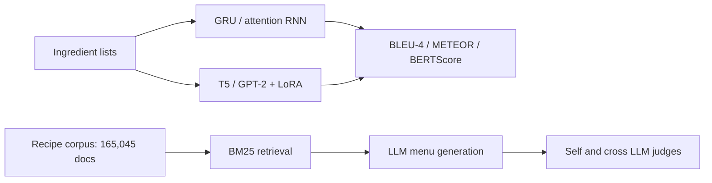
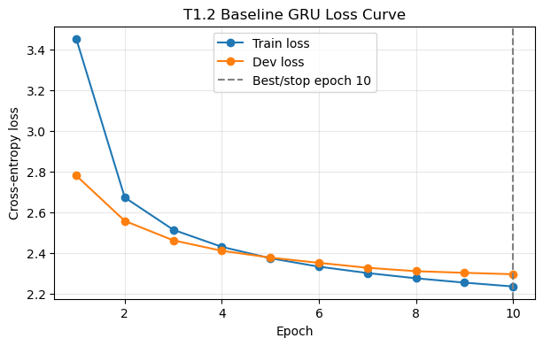
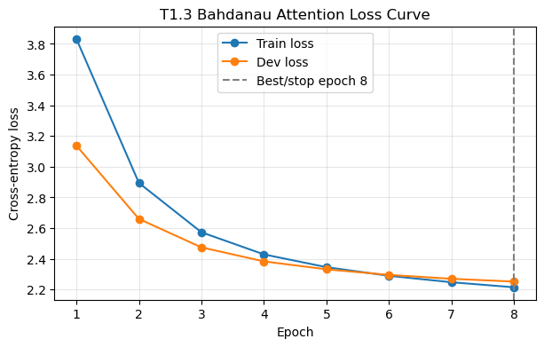
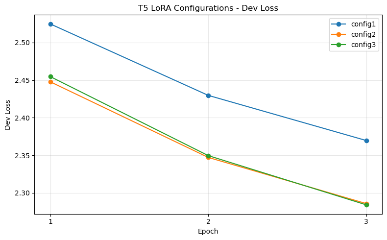
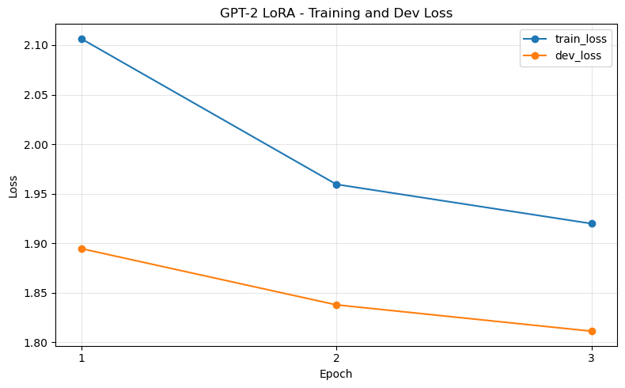
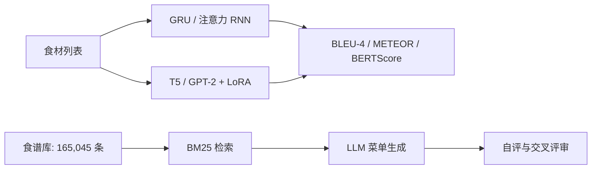

# Recipe Generation & LLM Evaluation

From ingredient lists to recipes and grounded menus: a compact comparison of sequence models, LoRA fine-tuning, retrieval, and LLM judging.

## Highlights

- Compared a PyTorch GRU baseline and attention RNN on **1,081 test recipes**; attention improved BLEU-4 by **22.1%** and METEOR by **5.1%**.
- Fine-tuned **T5-small and GPT-2 with LoRA**; GPT-2 achieved the highest METEOR (**0.2574**) while the attention RNN led BLEU-4 (**0.0905**).
- Indexed **165,045 recipes** with BM25 for a retrieval-augmented menu designer.
- Scored generated menus on **four dimensions** using both self- and cross-model LLM judges, then inspected disagreements.

## Pipeline overview



## Results

All recipe-generation scores below are from the 1,081-sample test set. T5 configuration 2 and GPT-2 beam search are the strongest settings of those models in the cross-model comparison; the additional settings are shown for transparency.

| Model / setting | BLEU-4 | METEOR | BERTScore |
|---|---:|---:|---:|
| GRU baseline | 0.0741 | 0.2415 | 0.8745 |
| Attention RNN | **0.0905** | 0.2538 | **0.8772** |
| T5-small + LoRA, config 1 | 0.0556 | 0.2094 | 0.8661 |
| T5-small + LoRA, config 2 | 0.0664 | 0.2172 | 0.8677 |
| T5-small + LoRA, config 3 | 0.0608 | 0.2135 | 0.8686 |
| GPT-2 + LoRA, greedy | 0.0438 | 0.2496 | 0.8560 |
| GPT-2 + LoRA, beam | 0.0534 | **0.2574** | 0.8607 |

Attention improved over the GRU baseline by **22.1% BLEU-4, 5.1% METEOR, and 0.3% BERTScore** (relative change). The metrics disagree on the overall winner: attention leads BLEU-4 and BERTScore, whereas GPT-2 beam leads METEOR.






## Key findings

- Attention helped the from-scratch encoder-decoder preserve ingredient context and improved every measured generation metric. [Attention heatmaps](assets/attention_heatmaps.png) expose some source-to-output alignment.
- More LoRA capacity improved T5 BLEU-4 between configurations 1 and 2, while changing target-module coverage in configuration 3 did not improve BLEU-4 further.
- The menu designer retrieves recipe evidence with BM25 before asking an LLM for a structured menu. Its judges score constraint satisfaction, source faithfulness, culinary coherence, and bias on a 1–5 scale.
- A judge sometimes treated a **retrieved source recipe** as if it were the **generated menu**, biasing its score. A clearer scoring rubric that separates those objects, plus human spot checks, is the next evaluation step.

## Project structure

```text
notebooks/   Three numbered, output-preserving analyses
src/         Data, training, model, evaluation, and RAG helpers
results/     Generated sample spreadsheet
assets/      Figures extracted from notebook outputs
```

## How to run

1. Use Python 3.10+ and install dependencies with `pip install -r requirements.txt`.
2. Copy `.env.example` to `.env` and set `GROQ_API_KEY` for the menu designer.
3. Open and run `notebooks/01_rnn_attention.ipynb`, `02_t5_gpt2_lora.ipynb`, and `03_rag_menu_designer.ipynb` in order.

The notebooks retain their executed results, but this public snapshot does **not** include the original training CSVs, checkpoints, or prediction JSON files referenced by some cells. Those inputs are required for a full rerun; the API key is required for live menu generation and judging.

## Tech stack

Python, PyTorch, Transformers, PEFT/LoRA, pandas, NLTK, sacreBLEU, BERTScore, BM25, Jupyter, and a Groq-compatible LLM API.

---

# 食谱生成与大语言模型评估

从食材列表生成食谱，再用检索证据设计菜单：比较序列模型、LoRA 微调、BM25 检索和 LLM 评审。

## 亮点

- 在 **1,081 条测试食谱**上比较 PyTorch GRU 基线与注意力 RNN；注意力模型的 BLEU-4 提升 **22.1%**，METEOR 提升 **5.1%**。
- 使用 LoRA 微调 **T5-small 和 GPT-2**；GPT-2 的 METEOR 最高（**0.2574**），注意力 RNN 的 BLEU-4 最高（**0.0905**）。
- 为菜单设计器建立包含 **165,045 条食谱**的 BM25 索引。
- 用自评和交叉评审两种 LLM 评审方式，从**四个维度**检查生成菜单，并分析分歧。

## 流程概览



## 结果

以下生成指标均来自 1,081 条测试样本。跨模型比较采用 T5 的配置 2 和 GPT-2 的 beam 解码；其他配置也列出，便于复核。

| 模型 / 配置 | BLEU-4 | METEOR | BERTScore |
|---|---:|---:|---:|
| GRU 基线 | 0.0741 | 0.2415 | 0.8745 |
| 注意力 RNN | **0.0905** | 0.2538 | **0.8772** |
| T5-small + LoRA，配置 1 | 0.0556 | 0.2094 | 0.8661 |
| T5-small + LoRA，配置 2 | 0.0664 | 0.2172 | 0.8677 |
| T5-small + LoRA，配置 3 | 0.0608 | 0.2135 | 0.8686 |
| GPT-2 + LoRA，greedy | 0.0438 | 0.2496 | 0.8560 |
| GPT-2 + LoRA，beam | 0.0534 | **0.2574** | 0.8607 |

相对于 GRU 基线，注意力模型的 BLEU-4、METEOR 和 BERTScore 分别相对提升 **22.1%、5.1% 和 0.3%**。指标并未选出同一个最优模型：注意力 RNN 在 BLEU-4 和 BERTScore 上领先，GPT-2 beam 在 METEOR 上领先。


## 主要发现

- 注意力机制帮助从头训练的编码器—解码器保留食材信息，三项指标均有提升；[注意力热图](assets/attention_heatmaps.png)展示了部分输入与输出的对应关系。
- T5 从配置 1 增加到配置 2 后 BLEU-4 提升；配置 3 扩大目标模块范围后，BLEU-4 没有继续提高。
- 菜单设计器先用 BM25 取回食谱证据，再要求 LLM 输出结构化菜单。评审按约束满足、来源忠实度、烹饪逻辑与连贯性、偏见四个维度打 1–5 分。
- 评审模型有时把**检索到的原食谱**误当作**生成菜单**来评分，造成偏差。下一步应明确区分两者的评分规则，并进行人工抽查。

## 项目结构

```text
notebooks/   三份按顺序编号、保留输出的分析 Notebook
src/         数据、训练、模型、评估和 RAG 辅助代码
results/     生成样本表格
assets/      从 Notebook 输出提取的图表
```

## 本地运行

1. 使用 Python 3.10+，执行 `pip install -r requirements.txt`。
2. 将 `.env.example` 复制为 `.env`，为菜单设计器设置 `GROQ_API_KEY`。
3. 依次运行 `notebooks/01_rnn_attention.ipynb`、`02_t5_gpt2_lora.ipynb`、`03_rag_menu_designer.ipynb`。

Notebook 保留了已执行结果，但此公开快照**未包含**部分单元格引用的原始训练 CSV、模型检查点和预测 JSON。完整复现需要这些输入；实时菜单生成与评审还需要 API 密钥。

## 技术栈

Python、PyTorch、Transformers、PEFT/LoRA、pandas、NLTK、sacreBLEU、BERTScore、BM25、Jupyter，以及兼容 Groq 的 LLM API。

## Context / 背景

Built as part of MSc in AI coursework. / 本项目完成于人工智能硕士课程学习期间。
